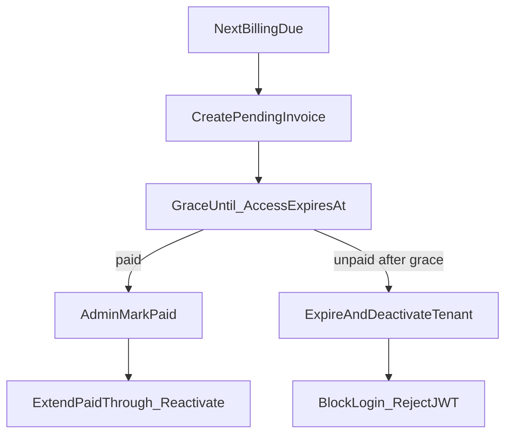

# SheikhGo Nexus — subscription billing

## Plans (USD / vehicle / month)

| Plan | Monthly list | Annual prepaid (15% off) | Platform fee |
|------|--------------|--------------------------|--------------|
| **Starter (Track)** | **USD 6** / vehicle | USD 61.20 / vehicle / year | None |
| **Pro (Optimize)** | **USD 12** / vehicle | USD 122.40 / vehicle / year | **USD 25 / mo** (waived on annual) |
| **Enterprise (ERP)** | **USD 20** / vehicle | USD 204.00 / vehicle / year | None (volume discounts at 100+) |

- **Meter:** licensed vehicle / GPS seat (`TenantSubscriptions.MaxGpsDevices`, minimum 1).
- **Default cycle for new provisions:** **Monthly** (admins may switch Monthly ↔ Yearly).
- **Pakistan market:** invoices and UI may store/display **PKR** = USD × `SubscriptionBilling:UsdToPkr` (default **280**). New PKR invoices store `ExchangeRateUsed`.
- **International:** **USD**.
- Public marketing: `/pricing` + home `#subscription-plans` with **USD | PKR** region toggle (EN / AR / DE).
- Public API: `GET /api/website/public/pricing` (list prices + FX).

Code source of truth: `SubscriptionPlanPricing`, `SubscriptionPlanCatalog`, ERP `PLAN_DEFINITIONS`.

### Add-ons (USD)

| Add-on | List |
|--------|------|
| AI Document OCR & Smart Fleet Assistant | USD 4 / vehicle / month |
| SMS / WhatsApp Alert Pack | USD 5 per 250 messages |

Tracker AMC (Essential / Plus / Premium at PKR 8k–10k / year / device) remains a **separate** hardware/support line.

## Paid-through vs access expiry

| Field | Meaning |
|-------|---------|
| `PaidThroughUtc` | End of the last **verified paid** period. Creating a Pending invoice **does not** advance this. |
| `AccessExpiresAtUtc` | `PaidThroughUtc + 7` days (grace). Hard cut-off for tenant access. |
| `NextBillingDate` | Next period due for **invoicing** (not proof of payment). |
| `SubscriptionEndDate` | Aligned to paid-through when an invoice is marked paid. |

## Lifecycle (ERP)

1. **Daily job:** `SubscriptionBillingHostedService` → `RunBillingCycleForAllTenantsAsync` (UTC, per-tenant try/catch).
2. **Invoice create (`AutoRenew=1`):** insert `TenantInvoices` Pending with `BillingPeriodStart/End` (+ `ExchangeRateUsed` for PKR). **Do not** advance `PaidThroughUtc` / `SubscriptionEndDate`. Duplicate Pending/Overdue / same period guards apply.
3. **`AutoRenew=0`:** no auto invoice; still deactivate at `AccessExpiresAtUtc` based on last paid-through + grace.
4. **PastDue:** when `asOf > PaidThroughUtc` and unpaid renewal exists → `Status=PastDue`, `FeaturesLocked=1` → HTTP **402** on modules except `DASHBOARD` / `ACCESS`.
5. **Expired + deactivate:** when `asOf > AccessExpiresAtUtc` without paid coverage → `Status=Expired`, `FeaturesLocked=1`, `Tenants.IsActive=0`, billing-history audit `SubscriptionExpired`.
6. **Mark paid (transactional):** invoice Paid + history + set `PaidThroughUtc` / `AccessExpiresAtUtc` / `SubscriptionEndDate` / `NextBillingDate` from invoice period end; clear lock; set `Status=Active`; `Tenants.IsActive=1` **unless** admin Suspended or other Overdue invoices remain.
7. **Admin Suspend / Cancel:** Suspend locks features; Cancel stops AutoRenew. Soft Reactivate only for Suspended with valid paid-through — **Expired requires mark-paid**.
8. **Auth hard gate:** login + refresh reject deactivated / Expired tenants (`tenant_deactivated` / `subscription_expired`). Authenticated ERP/driver APIs re-check via `TenantSubscriptionAccessMiddleware` (HTTP 403). Platform Super Admin exempt so billing can be fixed.
9. **Emails** (deduped via Notifications `TemplateKey` + reference): `subscription_invoice`, `subscription_overdue`, `subscription_expired`, `subscription_reactivated`, `subscription_renewal_reminder`.

### Existing subscribers

Historical invoice amounts/FX are **not** rewritten mid-cycle. Migration backfills `PaidThroughUtc` from `SubscriptionEndDate` / `NextBillingDate` and sets `AccessExpiresAtUtc = PaidThrough + 7d`.

## Revenue dashboard

Platform → **Subscription revenue**: active, MRR (`MonthlyAmount`), **ARR = MRR × 12**, outstanding, collections (30d), **expired** count, **deactivated** tenants, upcoming renewals, overdue accounts.

## Payment provider gaps

No Stripe/JazzCash/Easypaisa **subscription capture** is wired:

- Clients pay via agreed **bank transfer**; finance marks invoices paid manually in ERP.
- Per-trip **customer invoices** (Finance module) reuse the same email infrastructure but are a separate AR flow.

To enable automated checkout later: add a `ISubscriptionPaymentProvider`, webhook handler for `invoice.paid`, and map provider customer IDs on `TenantBilling` without duplicating trip invoice tables.
