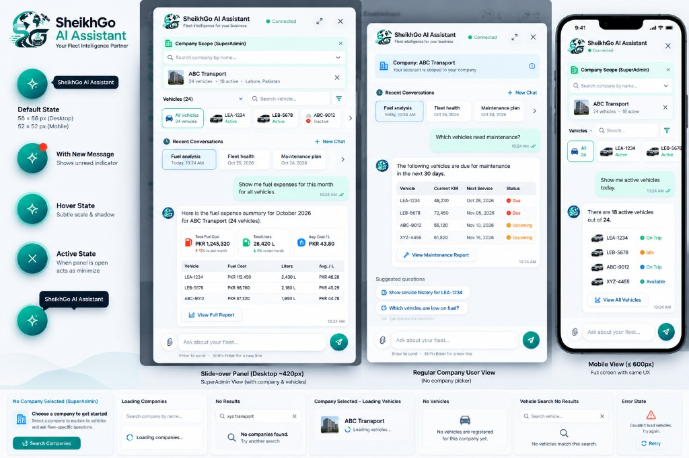

# SheikhGo — AI Assistant Redesign Plan

| | |
|---|---|
| **Product** | SheikhGo Enterprise ERP |
| **Component** | SheikhGo AI Assistant — Floating Chat and Full-Page Experience |
| **Target** | Angular / Angular Material ERP |
| **Document type** | Product design and UX implementation specification |
| **Design direction** | Calm, modern, enterprise messenger |
| **Visual mockup** | [AI-Assistant-Redesign-Mockup.jpg](./AI-Assistant-Redesign-Mockup.jpg) |

---

## Visual companion



This mockup is the visual companion to this written plan. It covers FAB states (default, new message, hover, active/close), the SuperAdmin slide-over with company scope and vehicle strip, the regular company-user view, mobile full-screen layout, and company/vehicle edge states (empty, loading, no results, no vehicles, error/retry).

---

## 1. Product Vision

Transform SheikhGo AI Assistant into a polished, context-aware enterprise assistant that allows fleet operators, company administrators, and SuperAdmins to ask business questions without leaving their current workflow.

The assistant should support questions about:

- Fleet health and vehicle utilization
- Drivers, trips, bookings, and route history
- Fuel consumption, expenses, and maintenance
- Revenue, invoices, and operational reports
- Company-specific fleet data
- Cross-company fleet analysis for SuperAdmins
- AI-generated summaries and structured business answers

### Core design principles

1. **Context first:** Users should always understand which company's data they are querying.
2. **Conversation first:** The chat must remain the primary focus, not a collection of dashboard cards.
3. **Consistent experience:** The floating assistant and full-page assistant must share the same visual language and interaction patterns.
4. **Compact but comfortable:** Use the available space efficiently without making messages or controls cramped.
5. **Enterprise-grade trust:** Clear status, permissions, readable answers, and explicit confirmation for consequential actions.
6. **Accessible by default:** Keyboard navigation, visible focus states, sufficient contrast, and predictable scrolling.

---

## 2. Visual Design Direction

### Aesthetic statement

Create a premium enterprise messenger integrated into a fleet management ERP. Use a white and soft-slate foundation, restrained teal branding, subtle borders, generous spacing, and structured AI responses.

The experience should feel like a professional business tool—not a consumer chatbot, a dashboard embedded inside another dashboard, or a playful AI interface.

### Visual treatment

- **Surfaces:** White cards and a soft neutral chat canvas.
- **Elevation:** One clear elevated drawer over the ERP; avoid excessive nested shadows.
- **Branding:** Teal for primary actions and selected states, not every element.
- **Message styling:** Minimal bubbles with clear user/assistant differentiation.
- **Data presentation:** Structured headings, tables, metrics, and compact report cards when relevant.
- **Motion:** Short, subtle transitions that communicate opening, closing, loading, and selection.

### Avoid

- Purple AI gradients and neon glow.
- A full teal-gradient header dominating the drawer.
- White bordered message cards inside another bordered white card.
- Permanently visible suggestion chips that squeeze the conversation.
- Multiple competing scrollbars.
- Repeated robot icons and repeated assistant branding.
- Tiny gray metadata that is difficult to read.

---

## 3. Overall Layout Architecture

### 3.1 Floating assistant experience

The drawer should follow this top-to-bottom hierarchy:

1. Assistant header with title, connection status, expand and close controls.
2. SuperAdmin-only company and vehicle scope region.
3. Optional compact recent-session selector.
4. Conversation area.
5. Contextual suggestions when appropriate.
6. Fixed composer dock at the bottom.

The company scope region belongs directly below the header and above the conversation. It must not be placed behind a menu, hidden in settings, or accessible only from the full-page assistant.

### 3.2 Wireframe — SuperAdmin

```
┌──────────────────────────────────────┐
│ SheikhGo AI Assistant   ● Connected  │
│ Fleet intelligence            ⤢   ×  │
├──────────────────────────────────────┤
│ COMPANY SCOPE                        │
│ [ Search or select a company      ▾ ]│
│                                      │
│ Selected: ABC Transport              │
│ 24 vehicles  ·  18 active             │
│ [All vehicles] [Active] [More...]    │
│                                      │
│ Selected vehicle: All vehicles   ▾  │
├──────────────────────────────────────┤
│ Recent conversation             + New│
│ [Fuel analysis] [Fleet health]       │
├──────────────────────────────────────┤
│                                      │
│ Assistant response                   │
│                                      │
│ User question                        │
│                                      │
│ Structured report / table / metrics  │
│                                      │
│ Contextual suggestions, when needed  │
│                                      │
├──────────────────────────────────────┤
│ Ask about this fleet...         [➤]  │
│ Enter to send · Shift+Enter newline  │
└──────────────────────────────────────┘
```

The diagram is conceptual. On narrow screens, the vehicle controls should use horizontal scrolling or a compact selector instead of forcing every vehicle into a row.

### 3.3 Wireframe — regular company user

```
┌──────────────────────────────────────┐
│ SheikhGo AI Assistant   ● Connected  │
│ Your fleet, at a glance        ⤢   × │
├──────────────────────────────────────┤
│ Company: Current Company              │
│ Fleet context is managed automatically│
├──────────────────────────────────────┤
│ Recent conversation             + New│
├──────────────────────────────────────┤
│                                      │
│ Conversation                         │
│ Structured AI responses              │
│                                      │
├──────────────────────────────────────┤
│ Ask about your fleet...          [➤] │
└──────────────────────────────────────┘
```

Regular company users must not see the cross-company search, company list, or controls for selecting another tenant. Their context remains restricted to their authorized company.

---

## 4. SuperAdmin Company and Vehicle Scope

This is a mandatory part of the redesign.

### 4.1 Company picker

Use a compact searchable combobox.

#### Default state

- Label: Company scope
- Placeholder: Search companies by name...
- Search icon at the leading edge.
- Dropdown results show company name and, when available, a secondary identifier or fleet count.
- The current selection is clearly indicated.

#### Search behavior

- Search as the user types, with a short debounce.
- Show a loading indicator while retrieving results.
- Keep the existing company selection until a different company is successfully selected.
- Support keyboard navigation and selection.
- Display an explicit no-results message.
- Provide a retry action on errors.

#### Company selection

When a company is selected:

1. Update the active tenant scope.
2. Retrieve vehicles belonging to that company.
3. Show the company name and vehicle count.
4. Update the assistant's conversation context for subsequent questions.
5. Ensure the backend validates the user's authorization and selected tenant.
6. Prevent an unanswered or previous-company query from being silently interpreted as belonging to the new company.

If the user switches companies during a conversation, display a clear context-change notice. Start a new scoped conversation or explicitly confirm how the new scope will apply to the existing conversation.

### 4.2 Vehicle strip

For the approximately 420px drawer, use a compact vehicle selector rather than a full vehicle table.

Recommended layout:

- A persistent company summary row.
- A small vehicle selector showing All vehicles by default.
- Optional horizontally scrollable vehicle chips or compact vehicle cards.
- A View all or Select vehicle control when the company has many vehicles.

Each vehicle entry may include:

- Registration number.
- Vehicle type or model, if available.
- A small status indicator.
- Selection state.

Do not attempt to display hundreds of vehicles at once.

#### Vehicle selection behavior

- All vehicles means the assistant can answer fleet-wide questions for the selected company.
- Selecting an individual vehicle narrows the context to that vehicle.
- Provide a clear way to return to All vehicles.
- Display the selected vehicle persistently while it remains active.
- Make the selection's scope explicit before sending a question.

### 4.3 Scope states

#### No company selected

- **Title:** Choose a company
- **Description:** Select a company to explore its vehicles and ask fleet-specific questions.

Disable or clearly gate fleet-specific questions until a company has been selected. Allow the user to select a company immediately.

#### Loading companies

Display a small inline loading indicator and `Loading companies...`.

#### No matching companies

Display `No companies found. Try another search.`

#### Company selected, vehicles loading

Show the selected company name immediately, retain a stable panel height, and display `Loading vehicles...`.

#### Company has no vehicles

Display `No vehicles are registered for this company yet.`

#### Vehicle search has no results

Display `No vehicles match this search.`

#### Error

Display a concise message such as `Couldn't load vehicles. Try again.` Provide a retry control.

#### Company switch

Show a brief notice:

> Company scope changed to ABC Transport.

If the previous conversation contains messages from another company, do not imply that those earlier messages have been rewritten to match the new scope.

### 4.4 Full-page company scope

Reuse the same company picker and vehicle selector on the full-page assistant.

On larger screens, the company summary and vehicle selector may occupy a wider context toolbar with more room for vehicle details. The scope must remain visible when the conversation scrolls.

On the full-page layout, the vehicle list can expand into a searchable list or a compact table if that adds real value. Keep the default view simple.

---

## 5. Floating Action Button (FAB)

### Recommended specification

- **Desktop size:** approximately 56 × 56 px.
- **Mobile size:** approximately 52–56 px.
- **Shape:** circular.
- **Color:** solid brand teal with a subtle elevation shadow.
- **Icon:** simple assistant/spark icon; avoid repeating a robot illustration everywhere.
- **Tooltip:** SheikhGo AI Assistant.
- **Accessible name:** Open SheikhGo AI Assistant.
- **Placement:** bottom-right, respecting viewport safe areas and other floating controls.

Use an approximately 180–240 ms opening animation.

The FAB should not compete with important ERP actions, notification controls, or mobile navigation.

### Open-state behavior

When the panel opens, transform the launcher into a persistent minimize/close target or retain a clearly accessible panel control. Do not make the assistant feel like it has disappeared from the interface.

If the panel is minimized, preserve the current conversation and scope.

---

## 6. Drawer Shell, Backdrop, and Elevation

### Desktop

- **Width:** approximately 420–460 px.
- **Height:** viewport height minus a comfortable top and bottom inset.
- **Right inset:** approximately 16 px.
- **Top and bottom inset:** approximately 16 px.
- **Border radius:** approximately 16 px.
- **Background:** white.
- **Border:** subtle neutral border.
- **Shadow:** pronounced enough to separate the drawer from the ERP without appearing heavy.

The exact width can be tuned after reviewing the existing ERP shell and available desktop viewport.

### Backdrop

Use a stronger neutral-slate backdrop, approximately `rgba(15, 23, 42, 0.40)` as a starting point.

- Clicking the backdrop closes the panel if no blocking workflow is active.
- If unsent input or a consequential confirmation would be lost, provide appropriate protection.
- Escape closes the drawer when allowed.
- Focus remains inside the modal drawer while it is open.
- Restore focus to the original FAB or launcher when closing.

### Layering

Define a documented layering policy for:

- FAB and drawer.
- Drawer backdrop.
- Material dialogs.
- Notification panels.
- Critical system dialogs.

The assistant must not accidentally render above a higher-priority confirmation or block a critical ERP workflow.

---

## 7. Header Design

### Layout

**Left side:**

- Assistant title: SheikhGo AI Assistant
- Subtitle: Fleet intelligence for your business

**Right side:**

- Connection/status indicator.
- Expand to full page.
- Close/minimize control.

### Typography and hierarchy

- **Title:** 18 px, semibold.
- **Subtitle:** 13 px, regular.
- **Status:** 12–13 px.

Use a white header or a very subtle neutral background with a teal accent. Avoid the current dense teal gradient.

The header should have consistent horizontal padding and adequate space around its icon buttons.

### Company context

Do not duplicate the full company picker in the header. Instead, keep the selected company visible in the dedicated scope region directly below it.

For normal users, a lightweight company label may be shown if it helps establish context.

---

## 8. Spacing System

Adopt a consistent 4/8-based spacing scale.

| Token | Value | Intended use |
|-------|-------|--------------|
| XS | 4 px | Icon-to-label gaps, compact metadata |
| SM | 8 px | Chip gaps, related controls |
| MD | 12 px | Compact section spacing |
| LG | 16 px | Main panel padding and standard gaps |
| XL | 24 px | Major section separation |
| 2XL | 32 px | Empty-state and page-level spacing |

### Recommended defaults

- Drawer inner horizontal padding: 16 px.
- Header padding: 16 px.
- Company scope padding: 12–16 px.
- Message spacing: 12 px.
- Message bubble padding: 12–14 px.
- Composer dock padding: 12–16 px.
- Chip gap: 8 px.
- Section gaps: 12–16 px.

Do not independently add large padding to the drawer, message container, and chat content. The chat should sit naturally on the drawer's surface instead of inside another unnecessary card.

---

## 9. Typography System

Use Inter as the preferred font family. If the ERP already uses a well-integrated system font, preserve the existing font to avoid inconsistent rendering.

| Role | Size | Weight |
|------|------|--------|
| Panel title | 18 px | 600 |
| Section title | 15–16 px | 600 |
| Message body | 14 px | 400 |
| Structured answer heading | 15–16 px | 600 |
| Composer text | 14–15 px | 400 |
| Suggestion chip | 13 px | 500 |
| Subtitle | 13 px | 400 |
| Metadata | 12 px | 400–500 |
| Table header | 12–13 px | 600 |

Use a consistent type ramp instead of many unrelated font sizes.

Long answers should support readable line length, paragraph spacing, headings, lists, and horizontal table scrolling when necessary.

---

## 10. Color Tokens

Use the following starting palette and validate the final contrast ratios.

| Token | Suggested value | Usage |
|-------|-----------------|-------|
| Primary teal | `#0F766E` | Primary actions and active states |
| Primary hover | `#115E59` | Hover and pressed states |
| Accent teal | `#0D9488` | Selected highlights and subtle emphasis |
| App surface | `#F8FAFC` | Conversation background |
| Panel surface | `#FFFFFF` | Drawer and composer |
| Border | `#E2E8F0` | Dividers and control borders |
| Primary text | `#0F172A` | Headings and message text |
| Secondary text | `#475569` | Descriptions and labels |
| Muted text | `#64748B` | Metadata and secondary status |
| User bubble | `#E0F2F1` | User messages |
| Assistant bubble | `#FFFFFF` | Assistant messages |
| Success | `#15803D` | Connected and successful states |
| Warning | `#92400E` | Pending confirmations |
| Warning surface | `#FFFBEB` | Confirmation background |
| Error | `#B91C1C` | Errors and access failures |
| Backdrop | `rgba(15, 23, 42, 0.40)` | Drawer backdrop |

Prefer a soft teal user bubble with dark text over a large solid teal block. Assistant messages should remain clearly distinguishable from the conversation canvas.

Use adequate contrast for all text, chips, statuses, and focus indicators. Do not use color alone to communicate status.

---

## 11. Message List and AI Responses

### Message presentation

Remove the bordered white messages container nested inside the gray body. Let the conversation canvas serve as the primary surface.

#### User message

- Right aligned.
- Soft teal background.
- Dark, readable text.
- Compact rounded corners.
- Optional timestamp in secondary text.

#### Assistant message

- Left aligned.
- White or transparent surface with minimal visual separation.
- Clear assistant identity without repeating the product title.
- Structured content when useful.

Use avatars sparingly. A small assistant icon may identify the assistant, but do not repeat the robot icon in the FAB, header, empty state, and every response.

### Structured response support

AI responses should not be rendered as unformatted text dumps.

Support:

- Headings and paragraphs.
- Bullet and numbered lists.
- Tables for vehicle or expense comparisons.
- Metric summaries for fleet questions.
- Clearly formatted date ranges.
- Loading indicators while a response is being generated.
- Error messages and retry actions.

Example response structure:

**Fleet fuel summary**

- Reporting period: October 1–26, 2026.
- Vehicles analyzed: 24.
- Highest fuel expense: shown with the relevant vehicle and amount.
- Additional detail: a compact table or link to the relevant ERP report.

These values are illustrative only; actual results must come from authorized business data.

### Long responses

- Keep the content width readable.
- Allow the message list to scroll independently.
- Avoid clipping tables and code-like output.
- Provide horizontal scrolling for wide tables when necessary.
- Keep dates, currencies, and units consistently formatted.

---

## 12. Suggestions and Prompt Chips

Suggestions should help users begin a conversation, not permanently occupy valuable space.

### Empty state

Display up to three suggestions:

- Which vehicles need maintenance?
- Compare fuel costs this month
- Show vehicles with low utilization

Use compact, neutral chips with a subtle border and a restrained teal hover state.

### After conversation starts

Hide the initial suggestion group after the first user message.

If helpful, show up to two contextual follow-up suggestions after an assistant response. Keep them optional and easy to dismiss.

### Layout rules

- Avoid multi-line chips whenever possible.
- Allow horizontal scrolling or controlled wrapping.
- Never let the chip area push the composer off-screen.
- Do not show five large chips continuously in compact mode.

---

## 13. Composer Dock

The composer is a primary interaction area and must remain stable at the bottom of the drawer.

### Recommended design

- White background with a subtle top divider.
- Multiline-friendly text area.
- Compact rounded outline.
- A short, clear placeholder.
- Compact circular send button aligned with the lower-right corner of the text area.
- A small helper line for keyboard behavior when space allows.

**Placeholder:** Ask about your fleet...

For a SuperAdmin without a selected company, use:

> Select a company to ask fleet questions.

### Interaction

- Enter sends the message.
- Shift+Enter creates a new line.
- Send button remains disabled when the message is empty or a required context is missing.
- During generation, provide a stop-generation control if supported.
- Preserve draft text if the panel is minimized.
- Do not allow chips, session history, or confirmation banners to cover the composer.

Avoid the heavy Material outline-field appearance and the oversized 56 × 56 px square send button.

---

## 14. Recent Conversations

### Compact drawer

Show a compact recent-session selector only when useful.

Recommended treatment:

- Header row: Recent and New chat.
- A short list of two or three recent sessions.
- Single-line titles with accessible full titles.
- Clear selected-session styling.
- Readable metadata.
- A View all option if the user has more sessions.

Do not reserve 110 px permanently for an internally scrolling list of recent conversations.

### No conversation history

Show a simple Start a new conversation action or let the empty state guide the user directly into asking a question.

Do not hide all discoverability behind a small icon.

### Full-page assistant

Use a wider history sidebar on large screens if sufficient space exists. On smaller screens, use a collapsible drawer or selector.

The conversation composer must remain comfortably wide and must not be squeezed by a permanent 220 px sidebar on compact layouts.

---

## 15. Confirmation and Consequential Actions

If the assistant proposes an action that changes ERP data, use a clear confirmation panel above the composer.

**Example:**

**Confirm action**

You are about to assign vehicle LEA-1234 to the selected trip.

**Actions:**

- Confirm
- Cancel

**Requirements:**

- Explain what will change.
- Show relevant entity names and identifiers.
- Never treat a suggestion chip as confirmation.
- Keep the confirmation panel compact.
- Preserve the message list's scrollable space.
- Do not stack multiple unrelated confirmation bars.
- Enforce permissions and validation on the backend.

For read-only questions, do not introduce confirmation UI unnecessarily.

---

## 16. Empty, Loading, Error, and Access States

### General empty state

- **Headline:** What would you like to know?
- **Description:** Ask about fleet performance, fuel costs, trips, maintenance, or revenue.

Use a small illustrative icon or minimal brand accent. Avoid repeating the product name.

### Connecting

Show `Connecting to SheikhGo AI...` with a subtle progress indicator.

Avoid a large, permanent connection strip that consumes space when the connection is healthy.

### Connected

Use a small status indicator and Connected in the header.

### Generating response

Show a lightweight typing or progress indicator in the conversation. Keep the composer behavior predictable.

### Failed request

**Message:** I couldn't retrieve that answer. Please try again.

Offer a retry action when appropriate. Do not silently discard the user's question.

### Access denied

**Message:** You don't have permission to view this information.

Do not expose restricted company or vehicle information in the error message.

### SuperAdmin: no company selected

- **Headline:** Choose a company to get started
- **Description:** Select a company above to view its vehicles and ask questions about its fleet.

Provide a clear route back to the company picker.

---

## 17. Responsive Behavior

### Desktop — wide screens

- Use the floating drawer with a width around 420–460 px.
- Keep the header, company scope, and composer stable.
- Allow only the conversation region to take most of the remaining height.
- Use the full-page assistant for complex reports or longer analytical sessions.

### Tablet — intermediate widths

- Use a narrower drawer if necessary.
- Reduce decorative padding before shrinking text.
- Keep company selection usable and vehicle controls compact.
- Avoid forcing full-page navigation when the drawer still fits comfortably.

### Mobile — narrow screens

Use a full-screen assistant with the same design language as the desktop drawer.

- Preserve the rounded, neutral header treatment where space permits.
- Respect top and bottom safe-area insets.
- Keep the composer above the mobile keyboard and home indicator.
- Make close/minimize and expand controls touch-friendly.
- Allow the SuperAdmin vehicle list to scroll horizontally or open a dedicated selector.
- Prevent the on-screen keyboard from hiding the send control.

### Short laptop and mobile viewports

- Prioritize the composer and conversation.
- Allow the recent-session region to collapse.
- Keep the company summary compact.
- Avoid fixed-height message containers.
- Ensure confirmation panels and loading indicators do not obscure the composer.

---

## 18. Scroll Ownership and Layout Stability

Define exactly one primary vertical scroll region for the conversation.

**Pinned regions:**

- Header.
- Compact SuperAdmin scope summary.
- Composer dock.

**Conditionally collapsible region:**

- Recent conversations.

**Scrollable region:**

- Message history and long AI responses.

**Separately scrollable when necessary:**

- Vehicle results inside their selector.
- A dropdown's company search results.

Avoid nested vertical scrolling between the drawer, chat container, messages, and suggestions.

The panel must never clip the bottom of the composer or a confirmation action.

---

## 19. Accessibility and Interaction Standards

- Provide visible keyboard focus indicators.
- Ensure every icon-only control has an accessible name.
- Maintain readable contrast for text and interactive elements.
- Support keyboard navigation in company and vehicle selectors.
- Trap focus inside the open modal drawer.
- Restore focus to the launcher when closing.
- Make Escape behavior predictable.
- Use accessible labels for loading, connection, and error states.
- Do not rely on color alone to indicate active scope or connection state.
- Ensure touch targets are comfortably sized.
- Announce meaningful status changes to assistive technology.
- Confirm consequential actions explicitly.
- Respect authorization at the backend, not only through hidden UI controls.

---

## 20. Full-Page Assistant Design

The full-page assistant must reuse the same core visual system and interaction rules as the floating assistant.

### Recommended structure

#### Top header

- Page title.
- Brief subtitle.
- Connection status.
- New conversation action.

#### Scope toolbar

- SuperAdmin company search.
- Selected company summary.
- Vehicle count.
- Vehicle selector.
- Optional active-vehicle filter.

#### Main content

- Conversation history.
- Structured assistant responses.
- Contextual suggestions.
- Fixed or naturally anchored composer.

#### Optional history panel

- Collapsible on narrower layouts.
- Expanded on wide screens when it does not reduce conversation readability.

Do not create a different company picker, composer, message style, or status system for the full-page version. Shared design behavior will reduce user confusion.

---

## 21. Recommended Microcopy

| UI element | Recommended text |
|------------|------------------|
| FAB tooltip | SheikhGo AI Assistant |
| Header title | SheikhGo AI Assistant |
| Header subtitle | Fleet intelligence for your business |
| Company picker label | Company scope |
| Company search | Search companies by name... |
| Vehicle selector | Select a vehicle |
| All-vehicle option | All vehicles |
| Company selection prompt | Choose a company to get started |
| No companies found | No companies found. Try another search. |
| Loading companies | Loading companies... |
| Loading vehicles | Loading vehicles... |
| No vehicles | No vehicles are registered for this company yet. |
| Vehicle search empty | No vehicles match this search. |
| Retry error | Couldn't load vehicles. Try again. |
| General empty state | What would you like to know? |
| General empty description | Ask about fleet performance, fuel costs, trips, maintenance, or revenue. |
| Composer placeholder | Ask about your fleet... |
| Composer helper | Enter to send · Shift+Enter for a new line |
| New session | New chat |
| Connected status | Connected |
| Connecting status | Connecting to SheikhGo AI... |
| Access denied | You don't have permission to view this information. |
| Scope-change notice | Company scope changed to {company name}. |

Use the actual company name from authorized application data rather than hardcoding the example.

---

## 22. Top 10 Implementation Priorities

Implement these in order, with accessibility and authorization tested throughout.

1. **Priority 1 — SuperAdmin tenant scope**  
   Add company search, selected-company context, vehicle loading, vehicle selection, empty states, and reliable tenant-context changes.

2. **Priority 2 — Stable composer dock**  
   Use a multiline-friendly composer, a compact send control, and a layout that cannot be crushed by other sections.

3. **Priority 3 — Predictable scroll behavior**  
   Pin the header, scope summary, and composer. Give the conversation a single primary scroll region.

4. **Priority 4 — Simplify the visual hierarchy**  
   Remove nested message cards, reduce excessive teal, and use a neutral enterprise messenger aesthetic.

5. **Priority 5 — Improve header hierarchy**  
   Clarify title, subtitle, status, expand, and close controls. Eliminate repetitive branding.

6. **Priority 6 — Fix responsive layouts**  
   Support desktop drawers, intermediate tablet widths, mobile fullscreen, short viewports, and safe-area insets.

7. **Priority 7 — Improve AI response formatting**  
   Support structured headings, lists, tables, date ranges, and readable metadata.

8. **Priority 8 — Redesign suggestion chips**  
   Show up to three suggestions in the empty state, then hide or replace them with contextual follow-ups.

9. **Priority 9 — Improve session history**  
   Make recent conversations easy to find without consuming excessive drawer height.

10. **Priority 10 — Accessibility and interaction polish**  
    Complete keyboard behavior, focus management, status announcements, confirmation states, error handling, and modal layering.

---

## 23. Acceptance Criteria

The redesign is ready for release when the following conditions are met.

### SuperAdmin scope

- SuperAdmin can search and select an authorized company.
- The company selection loads only that company's vehicles.
- The active company and vehicle scope remain visible while chatting.
- The assistant uses the selected scope for subsequent queries.
- Switching companies produces an explicit context change.
- Empty, loading, no-results, and error states are supported.
- Backend authorization prevents cross-tenant data leakage.

### Regular company users

- The cross-company picker is not visible.
- Their assistant remains scoped to their authorized company.
- The UI does not expose unauthorized company or vehicle data.

### Chat and composer

- The composer remains visible when the panel is open.
- Multiline questions work as expected.
- Messages do not get clipped.
- Structured AI answers remain readable.
- Suggestions do not permanently consume conversation space.

### Responsive behavior

- The drawer works at desktop and intermediate widths.
- Mobile uses a full-screen layout with safe-area support.
- The composer remains accessible when the keyboard opens.
- The interface works in short viewports without overlapping controls.

### Accessibility

- Keyboard navigation works.
- Focus is managed correctly when opening and closing the drawer.
- Controls have accessible names.
- Focus indicators and contrast are sufficient.
- Loading, error, and connection states are perceivable.

---

## 24. Final Design Recommendation

Build SheikhGo AI Assistant as a single reusable enterprise messenger system with two presentations:

1. **Compact floating assistant:** optimized for quick questions while the user continues working in the ERP.
2. **Full-page assistant:** optimized for longer conversations, richer reports, and more complex analysis.

Keep the company and vehicle scope immediately below the header for SuperAdmins. Keep the composer permanently accessible, use a neutral surface system with restrained teal accents, and prioritize readable AI responses over decorative interface elements.

The most important product improvement is not a visual effect—it is making the active company and vehicle context explicit, reliable, and safe. Once that is in place, the rest of the redesign should reinforce a clear, calm, and consistent enterprise experience.
