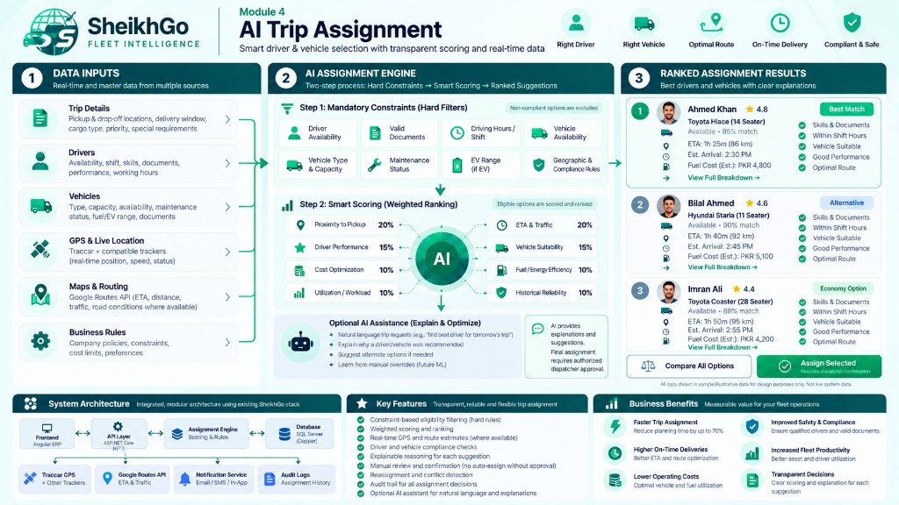
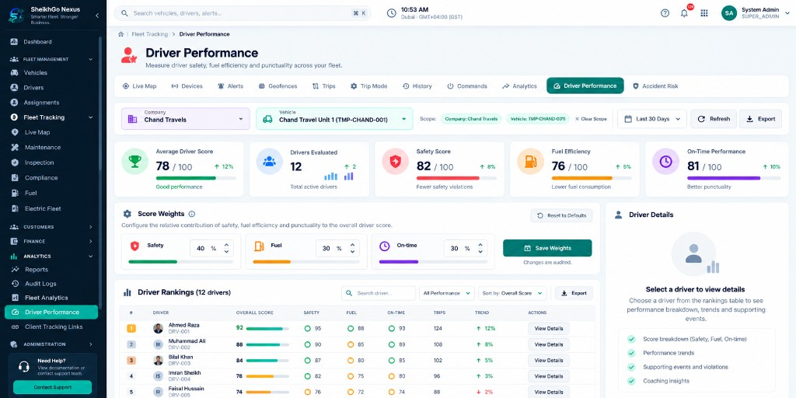

# Module 4 — Smart Trip Assignment

**Product name:** Smart Trip Assignment (not “AI auto-dispatch”)  
**Suite:** Fleet Intelligence · Module 4  
**Doc rule:** One master presentation per module — **update in place, never recreate**  
**Path:** `docs/presentations/MODULE-04-SMART-TRIP-ASSIGNMENT.md`  
**Sources:** `docs/FLEET-INTELLIGENCE-MODULE-AI-TRIP-ASSIGNMENT.md`, `docs/FLEET-INTELLIGENCE-IMPLEMENTATION-PLAN.md` (§A.4, §E.4, business card), Ali Module 4 overview slide  
**Audience:** Ali (product), ops / dispatch stakeholders, sales engineering  
**Status:** Presentation-ready · planning + interim decisions · screenshots partial (overview slide + Driver Performance filled; other slots empty)  
**Last updated:** 28 Oct 2026  

---

## How to use this deck-doc

1. Walk sections 1 → 7 in order for a live walkthrough.  
2. Pause on **§3 Twelve open decisions** — confirm or revise Ali’s interim defaults.  
3. Drop Ali’s screens into the **§8 Screenshot placeholders** (replace empty figure captions).  
4. Do **not** create a second Module 4 presentation file; edit this document only.

---

## 1. Plan summary / business objective

### Objective

Recommend the **most suitable available driver + vehicle** for a trip using **transparent constraint-based scoring** — mandatory filters first, then weighted rank + explainable factors — with **authorized staff confirm** before assignment becomes live.

### Business problem

Dispatchers pick drivers under time pressure. Manual choice can ignore fatigue, fuel/range, proximity, compliance, capacity, and fairness — causing late pickups, double-booking risk, and override disputes.

### Value

| Outcome | Why it matters |
|---------|----------------|
| Faster dispatch | Ranked shortlist instead of hunting the roster |
| Consistent policy | Same hard rules every trip |
| Auditable “why” | Factor breakdown + decision log |
| Fewer noncompliant offers | Hard filters never overridden by a high score |
| Measurable trust | Override rate, time-to-assign, shadow metrics before auto-apply |

### Positioning (honest)

| Use this name | Avoid implying |
|---------------|----------------|
| **Smart Trip Assignment** | ML/LLM picks the driver alone |
| Constraint-based / weighted scoring | Black-box “AI score” |
| AI-assisted *(optional marketing)* | Only if UI shows factor breakdown + optional NL explain later |

**Stack (verified truth):** Angular ERP · ASP.NET Core (**net10.0**) · SQL Server (Dapper) · Assignment engine (scoring & rules) · Traccar/GPS · Google Routes · Notification Service · Audit Logs. DeepInfra chat is **separate** and is **not** the assignment scorer.

> **Slide note:** Ali’s Module 4 overview mock lists API layer as “.NET 8”. **Repo truth remains net10.0** — keep that in copy and engineering notes; treat the slide as marketing layout, not stack source of truth.

**MVP today (partial):** Scorer + suggestions board (`/trips/smart-assignment`) + audit table + EV range hard-gate + driver reject → re-offer. Gaps vs Ali’s full vision: incomplete hard filters, create-time auto-assign policy conflict, cost/utilization not in scorer yet, no shadow dashboard.

**Pricing cue (suite plan):** Dispatch / Smart Ops tier.  
**KPIs:** Time-to-assign · suggestion→confirm · override rate + reasons · on-time pickup · reject/re-offer · GPS+Routes coverage % · hard-filter elimination rate.

---

## 2. Proposed flow

Aligned with Ali’s Module 4 overview slide (Data Inputs → Engine → Ranked results):

```
1. Data Inputs (real-time + master)
     Trip details · Drivers · Vehicles · GPS/live location · Maps & routing · Business rules
  → 2. AI Assignment Engine
       Step A: Hard filters (mandatory — fail = exclude)
       Step B: Smart scoring (weighted ranking)
  → 3. Ranked Assignment Results (top suggestions; Best Match / Alternative / Economy)
       → Staff: Compare options · Assign Selected (requires dispatcher confirmation)
  → Audit (TripSmartAssignmentDecisions)
  → Optional: reject → re-offer next · reassign / conflict via existing assign path
```

| Step | What happens |
|------|----------------|
| **1. Data inputs** | Trip (pickup/drop, window, cargo/type, priority, special reqs); drivers (availability, shift, skills, docs, performance, hours); vehicles (type, capacity, availability, maintenance, fuel/EV range, docs); GPS (Traccar + trackers); Google Routes (ETA, distance, traffic); company policies / cost limits / preferences |
| **2a. Hard filters** | Mandatory constraints — non-compliant options **excluded** (high score never overrides a fail) |
| **2b. Smart scoring** | Transparent weighted factors; ranked shortlist for UI/API |
| **3. Ranked results** | Top suggestions with match %, ETA, distance, estimated fuel/cost; **Assign Selected** only after authorized dispatcher confirmation |
| **4. Explain** | Factor list + weight % + detail text (UI already supports bars) |
| **5. Audit** | Log propose / confirm / override / reject / supersede with score JSON |

**Modes (target):** `SuggestOnly` (default) · `Shadow` (log “would assign”, no write) · `AutoApply` (tenant flag, only after shadow trust).

---

## 3. Twelve open decisions for Ali

> Numbered to match the Module 4 planning doc §14.  
> **Interim implementation defaults** (Ali, for hardening) are marked where chosen. Unmarked items still need a final call.

| # | Decision | Options / prompt | Interim default |
|---|----------|------------------|-----------------|
| **1** | Create-time auto-assign | Keep · disable globally · tenant flag default off | **No create-time auto-assign** — never confirm without authorization |
| **2** | Default operating mode | Suggest-only until confirm · one-click “Assign best” for `TripAssign` | **Suggest-only** |
| **3** | OnTrip drivers | Exclude entirely · allow if no schedule overlap | **Exclude OnTrip** |
| **4** | Drivers with no linked vehicle | Exclude · suggest driver-only, pick vehicle on confirm | **Exclude** (no vehicle → out) |
| **5** | Hard capacity / vehicle type | Always enforce when passenger count / type present? | *Still open* — planning intent: enforce when data present |
| **6** | Maintenance | Critical WO / overdue predictive = hard block · soft penalty | **Hard block** |
| **7** | Official soft weights | Approve slide target table · or keep MVP table · normalize to 1.0 | *Still open* — **slide mock sums to 110%** (see §4); needs Ali sign-off + normalize |
| **8** | EV range buffer | Keep ~15% · tenant-configurable 10–30% | **Keep 15%** (config later optional) |
| **9** | Product name | Smart Trip Assignment · market as “AI-assisted” | **Smart Trip Assignment** |
| **10** | LLM explain | DeepInfra AR/EN summary of factors · never | **No LLM explain** (for now); slide “optional AI assistance” = later |
| **11** | Cost / utilization | Defer Phase 6 · include in v1 hardening | **Include now** (cost + utilization in scoring scope) |
| **12** | Shadow before AutoApply | Require ~2 weeks shadow metrics · skip | **~2 weeks shadow** before any tenant enables AutoApply |

### Interim defaults — quick checklist

- [x] OnTrip → **exclude**  
- [x] No linked vehicle → **exclude**  
- [x] Maintenance critical → **hard block**  
- [x] EV buffer → **15%**  
- [x] Mode → **suggest-only**  
- [x] LLM explain → **no**  
- [x] Cost + utilization → **in scope now**  
- [x] Name → **Smart Trip Assignment**  
- [x] Shadow → **~2 weeks** before AutoApply  
- [x] Create-time auto-assign → **off / no**  
- [ ] Capacity / type hard rules — final wording  
- [ ] Soft weight table — formal sign-off (**fix 110% anomaly on slide**)  

---

## 4. Scoring factors

### Soft preferences — slide target table (Ali overview mock)

From Module 4 overview slide “Smart Scoring (Weighted Ranking)”. **Flag for Ali:** these percentages sum to **110%**, not 100%. Implementation must use weights that sum to **1.0** after Ali normalizes / rebalances.

| Factor | Slide weight | Notes |
|--------|--------------|-------|
| Proximity to pickup | **20%** | Live GPS / distance to pickup |
| ETA & traffic | **20%** | Google Routes ETA + traffic |
| Driver performance | **15%** | Performance / safety history (Driver Performance module) |
| Vehicle suitability | **15%** | Type, capacity fit, condition |
| Cost optimization | **10%** | Estimated route / operating cost |
| Fuel / energy efficiency | **10%** | Fuel or EV energy |
| Utilization / workload | **10%** | Fairness + fleet use |
| Historical reliability | **10%** | On-time / reliability history |
| **Sum on slide** | **110%** | **Anomaly — needs Ali fix before locking scorer** |

### Soft preferences (scored — current MVP in code)

Weights in `TripAssignmentScorer` today (must sum to **1.0**):

| Factor | Weight | Notes |
|--------|--------|-------|
| Driver rating | **0.22** | `Drivers.Rating` |
| Proximity to pickup | **0.18** | Live GPS / Google Routes |
| Fatigue (hours today) | **0.15** | Soft; from attendance — not hard HOS yet |
| Fuel / EV battery % | **0.15** | Neutral if telemetry missing |
| On-time pickup (ETA vs planned) | **0.15** | |
| Route / traffic | **0.15** | Google Routes; Haversine fallback |

### Soft preferences — target additions (Ali interim: **now**)

| Factor | Status | Notes |
|--------|--------|-------|
| Cost / route suitability | **In scope now** | Matches slide “Cost Optimization” once data quality OK |
| Utilization | **In scope now** | Matches slide “Utilization/Workload” |
| Driver performance / historical reliability | Candidate | Reuse Driver Performance module; slide shows both Performance 15% + Historical Reliability 10% |

UI must always show **named factors**, weights, and detail text — never a single opaque “AI score.”

---

## 5. Hard filters

Mandatory constraints: **fail → exclude** (never assign noncompliant because score is high).

### Slide hard-filter list (Module 4 overview)

| Constraint (slide) | Intent |
|--------------------|--------|
| Driver availability | Must be available for the trip window |
| Valid documents | License / docs current |
| Driving hours / shift | Hours and shift compliance |
| Vehicle availability | Vehicle free / assignable |
| Vehicle type & capacity | Fits trip type and load/passengers |
| Maintenance status | Not blocked by critical maintenance |
| EV range (if EV) | Range ≥ trip × buffer |
| Geographic & compliance rules | Geo / policy constraints |

Non-compliant options are **excluded** before scoring.

### Mapping to interim / today

| Constraint | Intent | Interim / today |
|------------|--------|-----------------|
| Driver available / not suspended-leave | Yes | Guard blocks Suspended/OnLeave; **OnTrip → exclude** (interim) |
| Shift / max hours (HOS) | Desired (slide) | Soft fatigue today; hard max hours still a gap |
| Vehicle present & available | Yes | **No linked vehicle → exclude** (interim) |
| Capacity ≥ passengers | Yes | Data exists; wire as hard filter when passenger count present |
| Vehicle type vs trip needs | Yes | Wire when type requirement present |
| License / verification / valid documents | Yes | Guard today; broader Document Tracker later |
| Maintenance critical | Yes | **Hard block** (interim) |
| Schedule conflict | Yes | Enforce at suggest-time + keep assign-path conflict SQL |
| EV range ≥ trip × buffer | Yes | **~15% buffer** hard skip |
| Geographic & compliance | Desired (slide) | Gap vs full vision — policy rules still evolving |

Excluded candidates should surface as a separate **excluded** list/count with reasons (capacity, docs, range, maintenance) — builds dispatcher trust.

---

## 6. Shadow mode

| Item | Plan |
|------|------|
| **Purpose** | Prove ranking quality without writing trip driver assignments |
| **Behavior** | Log “would assign X” (decision audit / metrics) — **no** live assignment write |
| **Duration** | **~2 weeks** shadow before any tenant enables **AutoApply** (suite validation + Ali interim) |
| **Exit criteria** | Acceptable override rate if applied; factor panel trusted by ops; hard-filter false-positive review OK |
| **Rollback** | Disable AutoApply flag; keep SuggestOnly + manual assign; retain decision rows |

Shadow sits between SuggestOnly and AutoApply. Create-time auto-assign stays **off** under interim policy. Slide: “Final assignment requires authorized dispatcher approval.”

---

## 7. Current surface (reference, not a second deck)

| Layer | Pointer |
|-------|---------|
| ERP | `/trips/smart-assignment` |
| APIs | `GET …/suggestions` · `POST …/auto` · `POST …/override` · `GET …/decisions` · `GET …/smart-assignment/recent` |
| Audit | `TripSmartAssignmentDecisions` (+ ScoreBreakdownJson) |
| Eng notes | `Backend/docs/TRIP_SMART_ASSIGNMENT.md` |
| Deep plan | `docs/FLEET-INTELLIGENCE-MODULE-AI-TRIP-ASSIGNMENT.md` |
| Architecture (truth) | Angular ERP · ASP.NET Core **net10.0** · Scoring & rules engine · SQL Server (Dapper) · Traccar · Google Routes · notifications · audit |

---

## 8. Screenshot placeholders

> Ali: paste/export screens below. Keep one slot per surface; update captions in place.

### 8.0 Module 4 overview slide (filled)



**Figure:** Module 4 overview — Data Inputs → AI Assignment Engine (hard filters then weighted scoring) → Ranked Assignment Results with **Assign Selected** (dispatcher confirmation). Architecture strip on slide says .NET 8; **product truth is net10.0**. Soft-weight ring on slide sums to **110%** — flagged for Ali in §4.

### 8.1 Suggest board (ranked list)

<!-- SCREENSHOT: suggest board -->

**Figure:** Smart Assignment — ranked driver suggestions for a selected trip.  
*(empty — drop screenshot here)*

### 8.2 Factor breakdown / explain panel

<!-- SCREENSHOT: factor explain panel -->

**Figure:** Candidate card — weight bars and factor detail text.  
*(empty — drop screenshot here)*

### 8.3 Staff confirm / assign best

<!-- SCREENSHOT: confirm assign -->

**Figure:** Confirm recommendation (or override with reason) before assignment writes.  
*(empty — drop screenshot here)*

### 8.4 Excluded candidates / filter reasons

<!-- SCREENSHOT: excluded reasons -->

**Figure:** Excluded count and top hard-filter reasons (capacity, docs, range, maintenance).  
*(empty — drop screenshot here)*

### 8.5 Decision audit / history

<!-- SCREENSHOT: decision audit -->

**Figure:** Assignment decisions trail (Proposed / Overridden / Rejected / Superseded).  
*(empty — drop screenshot here)*

### 8.6 Shadow metrics (when built)

<!-- SCREENSHOT: shadow metrics -->

**Figure:** Shadow-mode “would assign” metrics vs actual dispatcher choices.  
*(empty — drop screenshot here)*

### 8.7 Mode badge (Suggest / Shadow / Auto)

<!-- SCREENSHOT: mode badge -->

**Figure:** Operating mode indicator on Smart Assignment board.  
*(empty — drop screenshot here)*

### 8.8 Trip detail — suggest entry (optional)

<!-- SCREENSHOT: trip detail suggest -->

**Figure:** Trip detail entry point into Smart Assignment suggestions.  
*(empty — drop screenshot here)*

### 8.9 Driver Performance screen (filled)



**Figure: Driver Performance screen** — Analytics → Driver Performance (KPIs, configurable Safety / Fuel / On-time score weights, driver rankings). Feeds **Driver Performance** / reliability soft factors in Module 4 scoring (slide target); weight config on this screen is for performance scoring (sums to 100%), distinct from the assignment soft-weight table in §4.

---

## 9. Acceptance snapshot (future implementation)

- Mandatory failures never in ranked eligible list (or only in excluded + reason).  
- Soft weights documented and sum to **1.0** (slide mock currently **110%** — must be fixed before lock).  
- UI shows factor breakdown for every suggestion.  
- Confirm/apply writes audit with outcome; override logs reason.  
- Create-trip behavior matches **no unauthorized auto-confirm**.  
- Conflict detection remains on existing assign commands.  
- Ranking never requires an LLM call.  
- Copy does not claim ML/LLM assignment.  
- Stack copy uses **net10.0**, not the slide’s .NET 8 label.

---

## Related documents

| Doc | Role |
|-----|------|
| `docs/FLEET-INTELLIGENCE-MODULE-AI-TRIP-ASSIGNMENT.md` | Full planning / FR / gaps |
| `docs/FLEET-INTELLIGENCE-IMPLEMENTATION-PLAN.md` | Suite §A.4 · §E.4 · Phase 3 Dispatch |
| `docs/presentations/README.md` | Index of module presentation masters |
| `docs/presentations/assets/` | Embedded screenshots for this deck |
| `Backend/docs/TRIP_SMART_ASSIGNMENT.md` | Engineer API / signal notes |

---

*End of Module 4 master presentation — update this file in place only.*
